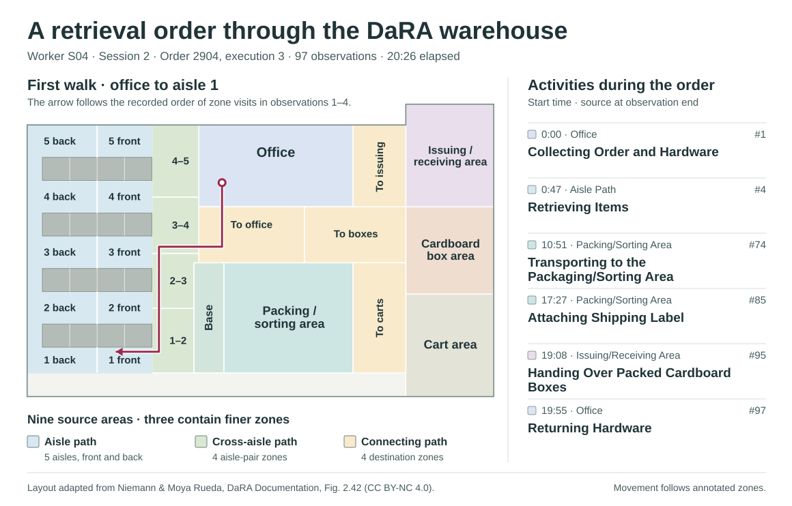
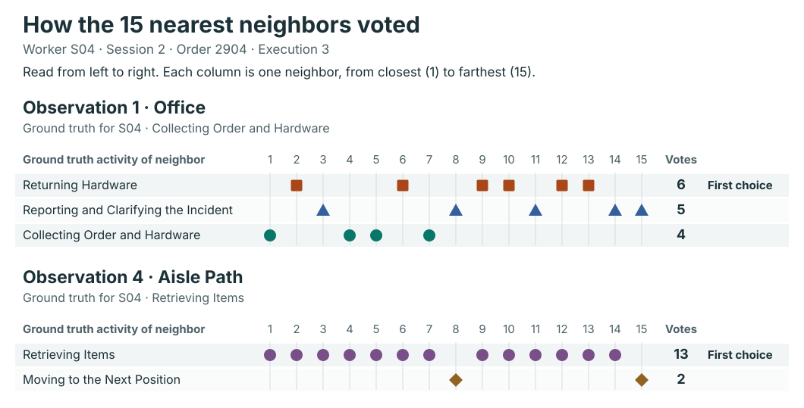

# MINEA evaluation artifacts

## DaRA retrieval event log

**[Open the XES event log](datasets/dara-retrieval/logs/dara_retrieval_gt.xes) · [Download the CSV](datasets/dara-retrieval/logs/dara_retrieval_gt.csv) · [Dataset and attribute guide](datasets/dara-retrieval/README.md) · [Reproduce the paper’s results](experiments/dara/README.md)**

The ground truth event log contains **53 warehouse retrieval runs, 4,984 events and 29 observed activities**. DaRA recorded the runs in **six recording sessions**. A session contains several runs by different workers. Each case is one worker’s execution of one order. Each event spans consecutive video frames with the same ground truth low-level process activity (DaRA category CC10). Both formats include the worker, order, session, start and end times, higher-level process context and warehouse locations.

### Follow one retrieval order through the warehouse

The map shows DaRA’s **nine warehouse areas**, each modeled as one source in the experiment. The location annotations distinguish **24 zones**. For example, the front and back of aisle 1 are two zones within the same *Aisle Path* source. An observation belongs to the source for the area where the worker was when it ended.



In session 2, worker S04 started order 2904 by collecting the order and hardware in the office. The fourth observation was *Retrieving Items* at the front of aisle 1. Later S04 attached shipping labels in the packing area, handed over the packed boxes in the issuing area and returned the hardware to the office. The arrow traces the first six recorded zones. Open the animated SVG in a browser to follow all **97 observations** in about **41 seconds** (30× playback). The highlighted zone changes at the recorded frame, while the activity label changes at the observation boundary. [Open the animated route](datasets/dara-retrieval/figures/warehouse_route_replay.svg) · [Area and zone definitions](datasets/dara-retrieval/README.md#warehouse-areas-and-zones)

### Regenerate the log

Download `Video__Revised_Annotations.zip` (5.2 MB) from DaRA v1 and leave it compressed in `datasets/dara-retrieval/raw/`. From the repository root, run the following with Python 3.9 or newer. The exporter uses the standard library and the included table of 53 run windows. It writes both formats to `reproduced/dara/logs/` and verifies the observation IDs, frame bounds, activity IDs and source areas against the experiment reference. [Zenodo files](https://zenodo.org/records/10468175#files) · [Exporter](datasets/dara-retrieval/export_log.py) · [Run windows](datasets/dara-retrieval/run_windows.csv)

```sh
python3 datasets/dara-retrieval/export_log.py --output-dir reproduced/dara/logs
cmp reproduced/dara/logs/dara_retrieval_gt.csv datasets/dara-retrieval/logs/dara_retrieval_gt.csv
cmp reproduced/dara/logs/dara_retrieval_gt.xes datasets/dara-retrieval/logs/dara_retrieval_gt.xes
```

The two comparisons finish silently when both files match. The logs and run windows use DaRA’s CC BY-NC 4.0 license. [Download and regeneration instructions](datasets/dara-retrieval/README.md#rebuild-from-zenodo) · [Attribution and data license](datasets/dara-retrieval/DATA-LICENSE.md)

## How the classifier generates scored activity candidates

We evaluate the **matching step of event abstraction**. In DaRA, each activity interval is one **observation**. DaRA supplies its boundaries, order and ending area. For matching, we also need possible activities and a score for each. We use a simple **15-nearest-neighbor classifier** to generate these **scored activity candidates** from wearable sensor readings and interval duration. Each score measures how strongly the readings support interpreting that observation as that activity.

We precomputed the ten highest-scoring candidates per observation and gave the same candidates and scores to all four methods. The classifier-only baseline takes the top candidate independently for each observation. We can then measure how enforcing process constraints changes the activity sequence produced for each order (its **abstracted trace**).

### Train on five sessions and predict the sixth

To generate candidates for observations from an unseen recording session, we keep all workers, runs and observations from that session together for testing. Training means storing each training observation’s sensor features and ground truth activity and computing the feature scales used to compare observations. We use the ground truth activities from the test session to evaluate its predictions.

For example, to generate candidates for **session 2**, we trained on **sessions 1, 3, 4, 5 and 6**. Those five sessions provided 4,092 labeled observations from 44 runs. The classifier then ranked candidate activities for all 892 observations from the nine runs in session 2. We gave each of the six sessions one turn as the test session. This is called **leave-one-session-out evaluation**. It gives six overlapping training sets and one final list of scored candidates per observation.

### Encode the readings as 397 numbers

We use one wearable set per worker and align each sensor clock to video frames using the two documented synchronization movements. For each observation, we summarize the Bluetooth Low Energy (BLE) and inertial measurement unit (IMU) readings recorded during its interval. We use the same encoding for training and testing.

| Input | Features | Encoding |
|---|---:|---|
| BLE signal | 342 | 57 beacons × 3 receivers (left wrist, torso, right wrist) = 171 channels. For each channel, record the mean of the finite signal-strength readings in dBm and the fraction of samples with a finite reading. A channel missing throughout gets −110 dBm and a detection fraction of 0. |
| Wearable motion | 54 | At each body site, the accelerometer and gyroscope each have three axes. The mean and population standard deviation of the 18 axes give 36 features. For each of the six three-axis vectors, compute its magnitude at every sample, then its mean, population standard deviation and 90th percentile over the interval. These add 18 features. |
| Duration | 1 | Take the natural logarithm of one plus the interval length in seconds. |

Consider the first observation of `session02_order2904_execution03`. Worker S04 spent 24.42 seconds in the office. The left-wrist receiver detected beacon B23 in 160 of 244 samples, with a mean signal strength of −86.19 dBm. That channel contributes two numbers to the vector, **−86.19** and **160/244 ≈ 0.656**. The replay models each warehouse area as a **source**. The office owns this observation for matching because the worker was there at the end of the interval. Area, zone, worker ID, order ID and process stage are excluded from the classifier features.

### Measure distance and vote

For S04’s office observation, the classifier asks which of the 4,092 labeled training observations have the most similar sensor readings and duration. It compares S04 with each of them, then uses the ground truth activities of the 15 closest observations to rank the candidates.

**Put the features on a common scale.** Consider the mean signal strength from beacon B23 at the left wrist. Across the training observations, its mean was −83.85 dBm and its standard deviation was 6.06 dBm. S04’s reading of −86.19 dBm was therefore **0.39 standard deviations below the training mean**. We standardize every feature this way so that differences in signal strength, motion and duration are measured in units of training variation.

**Find the closest observations.** For each pair, we square the difference on each standardized feature. A gap of two standard deviations contributes four times as much as a gap of one on the same feature. We average these squared gaps separately for BLE and for motion. We multiply each average by 171, then add both contributions and the squared gap in log-duration. This lets both sensor types count equally even though BLE supplies 342 features and motion supplies 54.

The closest observation to S04 was recorded for worker S18 in session 6 during *Collecting Order and Hardware*. Its B23 reading was −85.27 dBm, only 0.15 training standard deviations from S04’s. Across **all 397 features**, the BLE, motion and duration contributions were 65.734, 70.232 and 0.002, respectively, giving a distance of **135.968**. The next closest observation, labeled *Returning Hardware*, had a distance of **153.917**. Smaller distances rank first.

**Let each of the 15 neighbors vote once.** Read each panel from left to right. The first column is the closest training observation, and each mark is one vote for that neighbor’s ground truth activity. In the office, the closest neighbor voted for *Collecting Order and Hardware*, but *Returning Hardware* received the most votes overall. In the aisle, 13 neighbors agreed on *Retrieving Items*.



To obtain the candidate scores, we add 0.1 to each of the 31 activities’ vote counts. In the office example, six votes for *Returning Hardware* give $6.1/(15+31\times0.1)=61/181$. The ground truth activity, *Collecting Order and Hardware*, received four votes (41/181) and remains available to matching in third place. Seven activities with zero votes fill the remaining places in the top ten, each with score 1/181.

<details>
<summary>Exact distance and tie-breaking</summary>

The nearest neighbor in the example is `session06_order2905_execution03__activation0002`. Let $b$ be the mean squared gap across the 342 standardized BLE features, $m$ the mean squared gap across the 54 standardized motion features, and $t$ the squared gap in standardized log-duration. The distance is $D=171b+171m+t$. We use the training mean and population standard deviation for each feature, replacing a standard deviation below `1e-8` with 1. Equal distances retain training-row order. Equal vote counts are resolved by ascending activity ID.

The CSV lists the 25 closest of the 4,092 training observations for each example, with their IDs, ranks, ground truth activities and all three distance contributions. The figure shows the first 15, which cast the votes. To redraw it, run `python3 datasets/dara-retrieval/figures/plot_neighbors.py` from the repository root. [Neighbor data](datasets/dara-retrieval/figures/s04_neighbors.csv) · [Plotting script](datasets/dara-retrieval/figures/plot_neighbors.py)

</details>

## How we mined and selected the process constraints

The classifier scores candidate activities for one observation at a time. Process constraints express which candidates can be selected together during matching. We mined two kinds of constraints from the ground truth activity sequences. Both apply **within one retrieval order**, including when observations belong to different sources.

- **Prerequisite.** To find prerequisites for activity B, take each order containing B and list the activities completed before its first B. An activity A that appears in every such list is a candidate prerequisite. Other activities can occur between A and B, and one A can support several later occurrences of B.
- **Occurrence bound.** Count how often an activity occurs in each order. The largest observed count gives a candidate upper bound. For example, transport to the packing/sorting area occurred at most twice in each ground truth activity sequence.

Applying a process constraint to the candidates produces one or more inequalities, called **rows**. A source can check a local row on its own. A shared row links candidates owned by different sources.

### Which constraints qualified?

We used the same six training sets defined above. For example, when session 2 was the test session, we mined the ground truth activity sequences from sessions 1, 3, 4, 5 and 6. We repeated this for each choice of test session and found 141 prerequisites that held in all six training sets. For each of the 31 activity classes, we took the largest of its six observed maxima as a single occurrence bound that held in every training set.

### How much did each constraint improve the classifier’s predictions?

To rank the constraints, we needed predictions for runs **inside each training set**. Take the session 2 example again. We set session 2 aside, trained the classifier on sessions 3, 4, 5 and 6, and predicted session 1. Here session 1 is the **validation session**. Its ground truth activity sequences let us measure whether applying a constraint improved those predictions. We gave each of the five available sessions a turn as the validation session, then repeated the procedure for each choice of test session.

For each validation run, we compared the classifier’s first-choice activity sequence with the ground truth activity sequence. We counted the minimum number of activity insertions, deletions or substitutions needed to make them match (Levenshtein distance). Starting from the same candidate scores, we then chose the highest-scoring sequence allowed by **one constraint** and counted again. The reduction in edits was that constraint’s gain for the run.

Each run appeared in five training sets and contributed one validation prediction in each, giving **265 validation sequences** across the 53 runs. Of the 141 prerequisites, 133 qualified for ranking because their later activity occurred in every four-session training split. We ranked constraints by their total edits saved, breaking ties by the number of runs containing the later or capped activity, then by constraint ID. We kept the eight highest-ranked prerequisites and the two highest-ranked bounds. **All six sessions informed this retrospective choice of ten constraints.** For final matching, each observation received candidate scores from a classifier trained on the other five sessions.

| Rank | If an order contains this activity… | Requirement within that order | Validation edits saved by this constraint alone |
|---:|---|---|---:|
| 1 | Moving to the Next Position | At most 22 occurrences | 258 |
| 2 | Transporting to the Packaging/Sorting Area | At most 2 occurrences | 181 |
| 3 | Handing Over Packed Cardboard Boxes | Printing Shipping Label and Return Slip must already have finished | 109 |
| 4 | Transporting to the Packaging/Sorting Area | Placing Cardboard Box/Item in a Cart must already have finished | 76 |
| 5 | Reporting and Clarifying the Incident | Collecting Order and Hardware must already have finished | 63 |
| 6 | Moving to a Cart | Collecting Order and Hardware must already have finished | 61 |
| 7 | Placing Cardboard Box/Item in a Cart | Collecting Order and Hardware must already have finished | 61 |
| 8 | Moving to the Next Position | Collecting Order and Hardware must already have finished | 60 |
| 9 | Handing Over Packed Cardboard Boxes | Attaching Shipping Label must already have finished | 60 |
| 10 | Retrieving Items | Collecting Order and Hardware must already have finished | 60 |

## How we evaluated the abstracted traces

Matching selects **at most one candidate per observation**. Each selection yields an event with the selected activity, order identifier and interval times. Ordering the events by start time gives the **abstracted trace** for that order. In this replay, all four methods emitted one event for every observation.

The ground truth activity ranked first for 3,395 of 4,984 observations and appeared in the top ten for 4,734. MINEA and the centralized solver maximized the sum of the selected candidate scores with **all ten constraints enforced together**. With common tie-breaking, they produced identical abstracted traces for all 53 orders.

In S04’s run, the fourth observation was matched to **Retrieving Items**. Constraint 10 requires **Collecting Order and Hardware** to have finished by then. With all ten constraints applied, MINEA and the centralized solver selected that third-ranked candidate for the first office observation. This satisfied the prerequisite and matched the ground truth activity.

For each run, we measured the Levenshtein distance between the activity sequence of the abstracted trace and the ground truth activity sequence. We compared activity IDs, retained repeated labels and summed the distances over the 53 runs.

| Method | How activities were selected | Total trace edits |
|---|---|---:|
| Classifier only | Select the highest-scoring candidate independently for each observation | 1,581 |
| Source-local matching | Enforce the constraint rows each source can check on its own | 1,553 |
| MINEA | Enforce all ten constraints across the participating sources | 1,445 |
| Centralized matching | Enforce all ten constraints using the pooled candidate scores | 1,445 |

### Reproduce the DaRA results

From the repository root, this command checks the paper’s activity table, trace edits and recorded coordination measurements. It takes about a second with Python 3.9 or newer and uses only the files in the checkout.

```sh
python3 experiments/dara/reproduce.py --check-recorded --output-dir reproduced/dara
```

Look for **108 fewer trace edits (7.0%)** when comparing MINEA with source-local matching. The command writes the paper’s LaTeX activity table to `reproduced/dara/results/paper_activity_table.tex` and exports F1 and assignment counts for all 29 observed activities. [Table generation and output files](experiments/dara/results/README.md#generate-the-table-in-the-paper)

To run all four matching methods yourself, start with the released candidate scores or rebuild the scores from the original wearable archives. The reproduction guide gives both commands and explains how to compare fresh selections, activity F1 values and per-order coordination counts with the paper. [DaRA reproduction guide](experiments/dara/README.md)

## Earlier IKEA ASM evaluation

The IKEA ASM experiment studies how the number of sources and constraints linking cases affect matching. [Event logs and data preparation](docs/reviewer/README.md) · [Matching protocol](docs/EXPERIMENT.md) · [Recorded results](paper_output/ikea_sweep/REPORT.md)

<details>
<summary>Full IKEA ASM guide, installation and reproduction commands</summary>

This project contains the data, code and recorded results for the IKEA ASM
evaluation and Figure 3 of the **ICPM 2027 submission “Keep the Reads at Home:
Data-Minimizing Event Abstraction under Cross-Source Constraints”** by
**Henrik Kirchmann, Arik Senderovich and Matthias Weidlich**. Start with the
experimental setup below; the rest of this README explains the folder and
how to run the code.

### Experimental setup

We evaluate how the number of sources and constraints coupling otherwise
independent cases affect the size of coordinated matching problems and the
ability of B&B to solve them within a fixed time budget.

We use the **117 assembly recordings in the IKEA ASM test dataset**, because
this is the set for which the dataset authors provide classifier scores.
Each frame has a reference activity label—its **ground truth (GT)**—and a score
for each candidate activity. Our earlier uncertain-log repository groups
consecutive frames with the same GT label into one observation and averages
each activity's scores over those frames. We reuse its P3D export. Removing
NA (No Annotation) segments and the resulting empty case 38 leaves **116 cases
and 1,856 observations**.

Each observation has three scored candidates. These candidates and their
scores, three mined prerequisites and two occurrence bounds stay fixed.
The five-rule subset was chosen for practical runtime after the full mined
set reached the 300-second matching limit. We vary **source count
K = 1, 2, 4, 8** and **component count C = 116, 58, 29, 15, 8, 4, 2, 1**.
Synthetic inter-case constraints join cases in a tree of merges; their
candidate decisions stay on the same source. The central baseline collects
all candidates and scores. Matching receives 300 seconds for the entire log
per configuration, run sequentially on an M1 Pro with 16 GB RAM.

This is a controlled matching experiment with one seed and GT assistance.
It does not assess recognition accuracy on unseen data or parallel speedup.

Read the two experimental setup guides in order for all details explained:

1. **[Data preparation and intra-case constraints](docs/reviewer/README.md)** — why we use
   the test set and P3D, how frames become GT-aligned observations, candidate
   selection, NA removal, log statistics, and how the five intra-case constraints are mined.
2. **[Inter-case constraints and source placement](docs/coupling/README.md)** —
   how one constraint joins two cases, how the tree reduces the number of
   components, and how placement keeps each added constraint local to a source.

The [matching protocol and recorded results](docs/EXPERIMENT.md) specify the
budgets, execution order and interpretation of Figure 3. Open the
[vector figure](paper_output/ikea_sweep/figures/ikea-overview.pdf) or
[numerical results](paper_output/ikea_sweep/REPORT.md).

Data attribution: [IKEA ASM paper (Ben-Shabat et al., 2021)](https://openaccess.thecvf.com/content/WACV2021/html/Ben-Shabat_The_IKEA_ASM_Dataset_Understanding_People_Assembling_Furniture_Through_Actions_WACV_2021_paper.html),
[dataset website](https://ikeaasm.github.io/), and our
[uncertain-log repository](https://github.com/henrikkirchmann/IKEA_ASM_UncertainEventLogs)
associated with [Kirchmann et al. (2026)](https://doi.org/10.1007/s44311-026-00055-7).
Full references, the original authors' code and the pinned export version are
in [sources and citations](docs/SOURCES.md).

### Download event logs

[Download all event logs (ZIP)](docs/reviewer/downloads/ikea-asm-event-logs.zip),
or choose the [GT log (XES)](docs/reviewer/downloads/ground_truth.xes),
[uncertain log (XES.GZ)](docs/reviewer/downloads/uncertain_log.xes.gz),
[GT log (CSV)](docs/reviewer/downloads/ground_truth.csv), or
[uncertain log (CSV)](docs/reviewer/downloads/uncertain_log.csv).
All contain the experiment's 116 cases and 1,856 observations.

Case, activity and time are already mapped for process-mining tools such as
PM4Py. XES uses `concept:name` on traces for cases and on events for activities;
CSV uses `case:concept:name` and `concept:name`. Each observation is one
completed event, with `time:timestamp` at its segment end and `start_timestamp`
for its start (PM4Py's convention).

The GT files contain the ground truth activity sequences. In both uncertain formats,
`concept:name` is the highest-scoring candidate, not a constrained matching
result. All three candidates and their unchanged scores are preserved as JSON
payload in `probs_json`, following our earlier repository. See the
[format description and comparison with the older exports](docs/reviewer/README.md#download-event-logs)
and [loading examples](docs/reviewer/downloads/USAGE.txt).

### Project folder

| Location | Purpose |
| --- | --- |
| `docs/reviewer/` | Data-preparation guide, searchable HTML version, log statistics, complete rule catalogue and CSV/JSON tables. |
| `docs/reviewer/downloads/` | Experiment-aligned XES logs, CSV views with start/end times, and a ZIP download. |
| `docs/coupling/` | Inter-case constraint, merge-tree and source-placement guide. |
| `docs/EXPERIMENT.md` | Matching protocol, measured quantities and interpretation of the recorded results. |
| `inputs/reference/` | Prepared GT and uncertain logs, rule audits, model comparison and candidate-replacement records. |
| `inputs/provenance/` | Frozen merge plan, rule-selection records and the inputs needed to verify them. |
| `minea_ikea/` | Data preparation, constraint encoding, distributed construction and matching implementation. |
| `results/benchmark_sweep/` | Recorded study: 32 constructions, 32 distributed matching jobs, eight central jobs, code snapshots and file hashes. |
| `paper_output/ikea_sweep/` | Figure 3, plotting data, numerical report and the paper's evaluation fragment. |
| `tests/`, `examples/` | Automated checks and the small integration-test example. |
| `review.py`, `reviewer/` | Generators for the data guide, statistics and vector illustrations. |
| `provenance/` | Current release checks, source provenance, and an inventory explaining each retained file. |

The included files suffice for the commands below; the original workspace and
paper are not required. Raw videos, downloaded upstream exports, earlier
pilot results and a Python environment are not bundled. The original 73 mined
rules remain in the inputs so the frozen merge plan can be checked; only the
five documented rules are applied in the sweep.

The recorded sweep is preserved as one evidence folder. Some instances and
code snapshots occur twice because the verifier compares preparation with
construction and checks the code used for the recorded runs. These copies and
the original manifests are retained for that purpose. Development caches and
superseded documentation-check reports are excluded from this release.

### Code entry points

| Part of the evaluation | Code |
| --- | --- |
| Prepare observations and mine intra-case constraints | [run.py](run.py), [data.py](minea_ikea/data.py), [mining.py](minea_ikea/mining.py). |
| Add inter-case constraints and assign sources | [sweep_instances.py](sweep_instances.py), [instances.py](minea_ikea/instances.py). |
| Construct the distributed matching model | [construction.py](minea_ikea/construction.py). |
| Match candidates and run the central baseline | [matching.py](minea_ikea/matching.py), [solver.py](minea_ikea/solver.py), [benchmark.py](benchmark.py). |
| Run the 32 configurations and 40 matching jobs | [sweep.py](sweep.py). |
| Verify the saved results independently | [verify_sweep.py](verify_sweep.py), [verify_benchmark.py](verify_benchmark.py), [reference.py](minea_ikea/reference.py). |
| Produce Figure 3 and its tables | [analyze_sweep.py](analyze_sweep.py), [plot_sweep.py](plot_sweep.py). |
| Produce the data guide and event-log downloads | [review.py](review.py), [reviewer/](reviewer/). |

### Install

Run these commands from this project folder. Python 3.10 or later is required;
the recorded study used Python 3.11.
The matching runner uses POSIX resource accounting and runs on macOS or Linux
(including a Linux environment under Windows). PM4Py is optional for reading
the exported logs; it is not a dependency of the experiment.

```sh
python3 -m venv .venv
source .venv/bin/activate
python -m pip install -r requirements.txt
```

### Check the included data and results

```sh
python -m unittest discover -s tests -v
python verify.py
python verify_sweep.py results/benchmark_sweep
```

These commands check the included logs and rules, saved file hashes,
construction equivalence, matching feasibility, objective values and bounds.
They do not rerun matching. Saved large-instance optimality claims rely on the
exact Z3 backend; checking its recorded results is not an independent proof
replay. The [manual review walkthrough](docs/MANUAL_REVIEW.md) gives concrete
observations, rules and configurations to inspect yourself.

### Rebuild and rerun the experiment

Use a fresh output directory. First prepare all 32 configurations and run
construction; then start the matching sweep:

```sh
python sweep.py --prepare-only --output results/reproduction
python sweep.py --resume --output results/reproduction
python verify_sweep.py results/reproduction
```

The second command runs 40 matching jobs sequentially: 32 distributed settings
and one central run for each of eight component counts. Each has a 300-second
budget for the whole log; distributed B&B also has a 100,000-node cap. The sum
of these budgets is 3 h 20 min, plus construction, checking and process overhead.
Limits are cooperative and can overrun slightly. Timings and the number of
cases solved within the limit may vary between runs and machines.

Use `results/reproduction` for new runs. The included `results/benchmark_sweep`
records the original experiment and its measured code snapshots.
Rebuilding the prepared inputs is optional; see
[rebuilding inputs from the earlier log exports](docs/SOURCES.md#rebuild-inputs-from-the-earlier-log-exports).

### Regenerate the data guide and statistics

```sh
python -m pip install -r requirements-figures.txt
python review.py
```

This regenerates [the data-preparation guide](docs/reviewer/README.md), its
[offline HTML version](docs/reviewer/index.html), the rule catalogue, five
vector illustrations and all descriptive CSV/JSON tables from local inputs.
It also prepares the downloadable event-log bundle and CSV views.
Open the HTML file in a browser after downloading the folder; GitHub displays
its source. No raw download, TeX installation or matching rerun is needed.
The [metric dictionary](docs/reviewer/DATA_DICTIONARY.md) defines the statistics.
The inter-case and source-placement guide is maintained separately. Regenerate
its checked example with `python -m reviewer.coupling`.

### Regenerate Figure 3

Install the optional plotting dependency and TeX Live with `pdflatex`, Libertine
and `newtxmath`. Viewing the included PDF requires none of these dependencies.

```sh
python -m pip install -r requirements-figures.txt
python analyze_sweep.py --input results/benchmark_sweep --output paper_output/reproduction
```

This checks the saved sweep and generates Figure 3 as a vector PDF and PGF,
along with plotting data, a report and LaTeX numbers. To plot a new run, use
`--input results/reproduction`. The included `evaluation.tex` is a paper-section
snapshot for inclusion in the manuscript; the plotting command does not edit it.

### License and citation

The original evaluation code is released under the [MIT license](LICENSE).
The event logs and other dataset-derived records are based on IKEA ASM and
remain subject to its
[Creative Commons Attribution-NonCommercial 4.0 International terms](https://creativecommons.org/licenses/by-nc/4.0/),
as stated on the [dataset website](https://ikeaasm.github.io/#license).
[THIRD_PARTY_NOTICES.md](THIRD_PARTY_NOTICES.md) records the source attribution,
license scope and changes made to the data.

When reusing these inputs, please cite the original IKEA ASM dataset paper and
our earlier uncertain-event-log work linked above. Reusable citations are in
[references.bib](references.bib) and [CITATION.cff](CITATION.cff).

</details>
